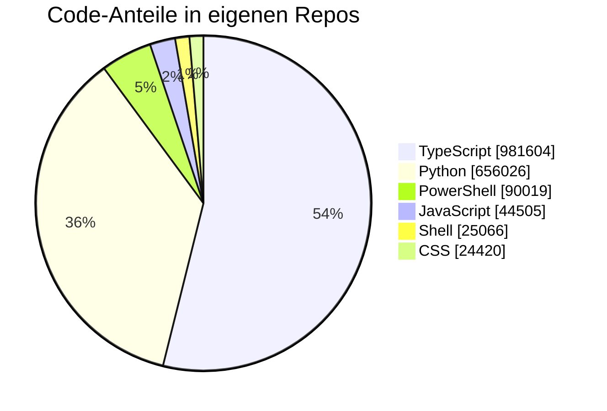

## 👋 Hi, ich bin Norman

Ich sitze in Dresden und baue Software, die Arbeit abnimmt: Desktop-Apps, KI-Workflows mit Claude und kleine Automatisierungen, die jeden Tag ein paar Minuten sparen. Fast alles hier ist zweisprachig (DE/EN) dokumentiert und für Leute gemacht, die keine Lust auf Kommandozeilen haben.

<!-- STATS:START -->
| 📦 Installer-Downloads | 🔄 Update-Anfragen | 🔀 Pull Requests | ⭐ Sterne |
|:---:|:---:|:---:|:---:|
| **119** | **122** | **48** | **7** |

Downloads und Update-Anfragen zählen die Release-Assets aller Repos. Stand: 24.11.2026, wird wöchentlich automatisch aktualisiert.
<!-- STATS:END -->

## 🚀 Projekte

### 🎤 [UltraStar – Dirty Little Helper](https://github.com/normannormalmann/ultrastar-dlh)

Desktop-App, die eine UltraStar-Karaoke-Sammlung aufbaut, pflegt und durchsuchbar macht. Fehlt ein Lied in der Datenbank, trennt eine KI die Stimme ab, legt den Text auf den Gesang und erkennt die Tonhöhen. Gebaut für Melody Mania, UltraStar Deluxe, Vocaluxe und UltraStar Play.

<b>📈 Downloads je Release ansehen</b>

Balken: Installer (Windows + Linux). Linie: Update-Checks installierter Apps (`latest.yml`). v1.4.0 war zwei Monate lang die aktuelle Version und hat deshalb die meisten Update-Anfragen gesammelt.

### 🎬 [Claude Motionreel Generator](https://github.com/normannormalmann/Claude-Motionreel-Generator-CMG)

Ein eigenes Studio für KI-erstellte Motion-Design-Videos, eingerichtet mit einem Doppelklick. Du beschreibst das Video in normalen Worten, Claude baut die Animation, prüft die Einzelbilder und rendert ein MP4. Läuft auf Windows, macOS und Linux.

### 🧰 Claude & Automation Toolbox

| Projekt | Was es macht | Stack |
|---|---|---|
| [**Claude-Multiverse**](https://github.com/normannormalmann/Claude-Multiverse) | Mehrere isolierte Claude-Desktop-Instanzen nebeneinander, z. B. Arbeit und Privat, ohne ständiges Ab- und Anmelden | PowerShell |
| [**meta-ads-mcp-secure-launcher**](https://github.com/normannormalmann/meta-ads-mcp-secure-launcher) | Gehärteter Launcher für den Meta-Ads-MCP: Zugangsdaten im Credential Manager, Token-Maskierung in Logs, Schreibschutz für Budgets | Python |
| [**hubspot-skills**](https://github.com/normannormalmann/hubspot-skills) | Claude Skills, die HubSpot-Sequenzen bauen, testen und Kontakte automatisch einschreiben, inklusive der Fehler, die HubSpot nicht erklärt | Claude Skills, n8n |
| [**timebutler_auto**](https://github.com/normannormalmann/timebutler_auto) | Stempelt automatisch in Timebutler ein, sobald der Rechner im Büro-WLAN ist, oder ganztägig per n8n | Python, Playwright, Docker |

<b>🍴 Forks & Beiträge</b>

- [streambert-german](https://github.com/normannormalmann/streambert-german): Electron-Streaming-App, um deutsche Streams erweitert
- [awesome-claude-skills](https://github.com/normannormalmann/awesome-claude-skills): kuratierte Liste von Claude Skills
- [winget-pkgs](https://github.com/normannormalmann/winget-pkgs): Fork für die Veröffentlichung im Windows Package Manager

## 🛠️ Womit ich arbeite

## 📊 GitHub in Zahlen

> 📈 **Interaktive Statistik mit Verlauf, Filtern und Downloads pro Tag: [normannormalmann.github.io](https://normannormalmann.github.io#stats)**

<b>🥧 Wo der Code liegt (Bytes je Sprache)</b>

