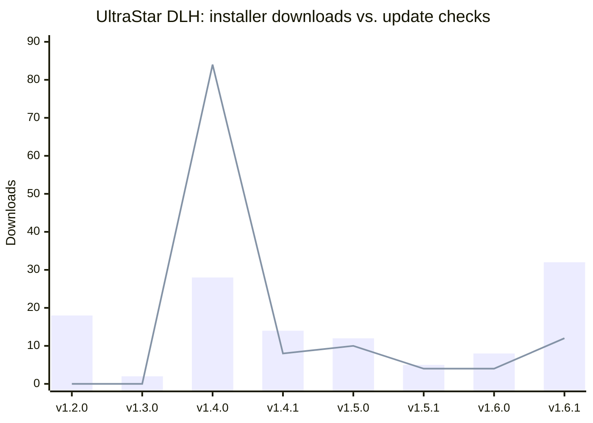
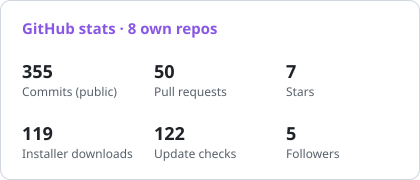
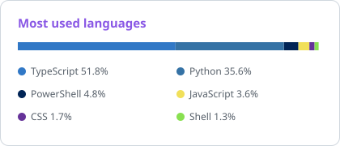
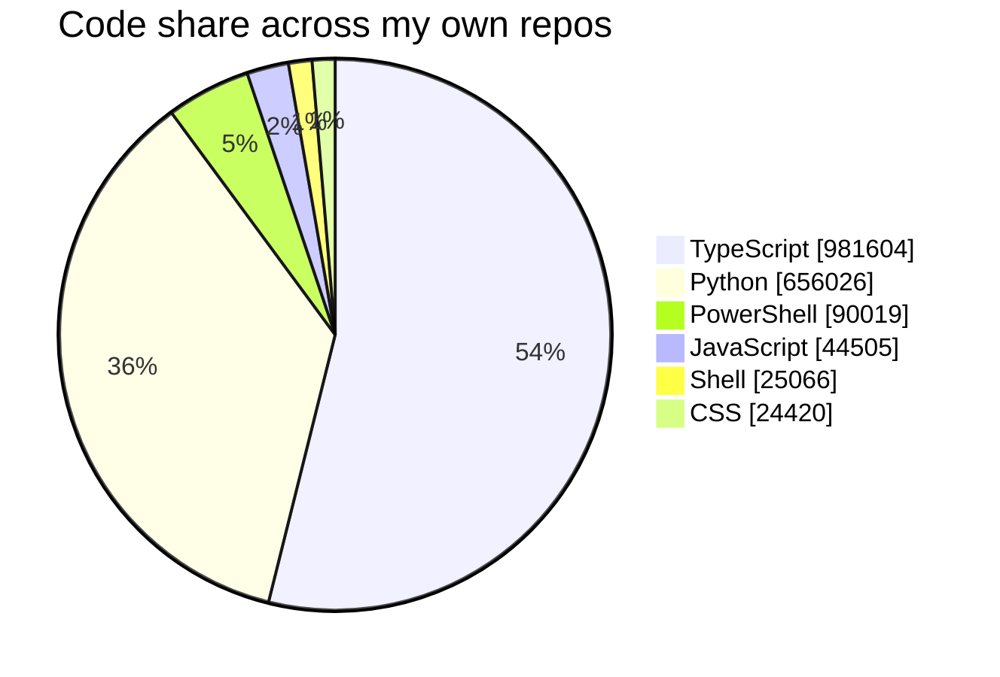

🇬🇧 English · 🇩🇪 <a href="https://github.com/normannormalmann/normannormalmann/blob/main/README.de.md">Deutsch</a>

## 👋 Hi, I'm Norman

I'm based in Dresden, Germany, and I build software that takes work off people's plates: desktop apps, AI workflows with Claude and small automations that save a few minutes every day. Almost everything here is documented in English and German and made for people who'd rather not touch a command line.

<!-- STATS:START -->
| 📦 Installer downloads | 🔄 Update checks | 🔀 Pull requests | ⭐ Stars |
|:---:|:---:|:---:|:---:|
| **119** | **122** | **50** | **7** |

Downloads and update checks count release assets across all repos. As of 2026-11-24, refreshed automatically every week.
<!-- STATS:END -->

## 🚀 Projects

### 🎤 [UltraStar – Dirty Little Helper](https://github.com/normannormalmann/ultrastar-dlh)

A desktop app that builds, maintains and searches your UltraStar karaoke collection. If a song is missing from the database, an AI separates the vocals, aligns the lyrics to the singing and detects the pitches. Built for Melody Mania, UltraStar Deluxe, Vocaluxe and UltraStar Play.

<b>📈 Downloads per release</b>

Bars: installers (Windows + Linux). Line: update checks from installed apps (`latest.yml`). v1.4.0 was the current version for two months, so it collected the most update checks.

### 🎬 [Claude Motionreel Generator](https://github.com/normannormalmann/Claude-Motionreel-Generator-CMG)

Your own studio for AI-made motion design videos, set up with a double-click. Describe the video in plain words, Claude builds the animation, checks the frames and renders an MP4. Runs on Windows, macOS and Linux.

### 🧰 Claude & automation toolbox

| Project | What it does | Stack |
|---|---|---|
| [**Claude-Multiverse**](https://github.com/normannormalmann/Claude-Multiverse) | Run several isolated Claude Desktop instances side by side, e.g. work and private, without logging in and out | PowerShell |
| [**meta-ads-mcp-secure-launcher**](https://github.com/normannormalmann/meta-ads-mcp-secure-launcher) | Hardened launcher for the Meta Ads MCP: credentials in the Windows Credential Manager, token masking in logs, write guard for budgets | Python |
| [**hubspot-skills**](https://github.com/normannormalmann/hubspot-skills) | Claude skills that build and test HubSpot sequences and auto-enroll contacts, including the errors HubSpot doesn't explain | Claude Skills, n8n |
| [**timebutler_auto**](https://github.com/normannormalmann/timebutler_auto) | Clocks you in to Timebutler as soon as your PC joins the office Wi-Fi, or runs the whole day via n8n | Python, Playwright, Docker |

<b>🍴 Forks & contributions</b>

- [streambert-german](https://github.com/normannormalmann/streambert-german): Electron streaming app, extended with German streams
- [awesome-claude-skills](https://github.com/normannormalmann/awesome-claude-skills): curated list of Claude skills
- [winget-pkgs](https://github.com/normannormalmann/winget-pkgs): fork for publishing to the Windows Package Manager

## 🛠️ What I work with

## 📊 GitHub in numbers

> 📈 **Interactive stats with history, filters and downloads per day: [normannormalmann.github.io](https://normannormalmann.github.io#stats)** (in German)

<b>🥧 Where the code lives (bytes per language)</b>

